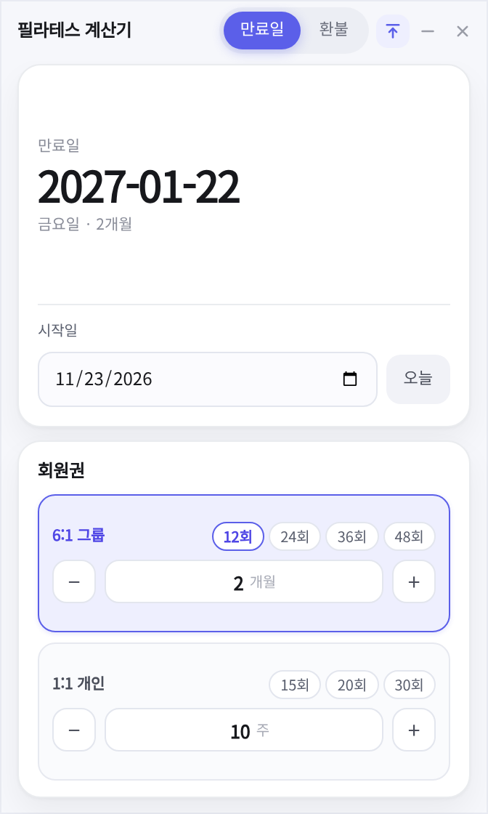
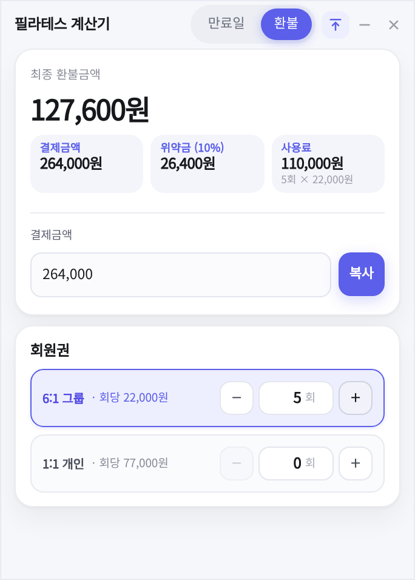

# 필라테스 계산기

필라테스 센터 데스크에 띄워 두는 **미니 위젯**(윈도우 데스크톱 앱)입니다. 회원권 **만료일**과 **환불금액**을
작은 창에서 바로 계산합니다.

 

## 받는 곳

[Releases](../../releases) 에서 내려받습니다.

- `PilatesCalc-Setup.exe` — 설치 파일 (시작 메뉴·바탕화면 바로가기)
- `PilatesCalc-Windows.zip` — 설치 없이 쓰는 포터블 버전

윈도우 11에는 필요한 **WebView2 런타임**이 기본 탑재되어 있습니다. 윈도우 10에서 창이 비어 있으면
[WebView2 런타임](https://developer.microsoft.com/microsoft-edge/webview2/)을 설치해 주세요.

## 위젯 사용

- 기본 크기 **342 × 478** (최소 **316 × 460**) 의 작은 창입니다. 카드가 내용만큼만 높이를 차지해 위아래 빈 공간이 없고, 테두리 없는 창이라 상단 제목 부분을 잡고 옮깁니다.
- 상단 오른쪽 **항상 위 고정**(핀) 토글과 최소화·닫기 아이콘.
- 만료일 탭 맨 위 카드 하나에 **만료일 결과 · 시작일 입력** 이 함께 들어 있습니다. 만료일이 큰 글씨로 보이고, 구분선 아래에서 달력으로 시작일을 바꾸거나 `오늘`로 되돌립니다.
- 만료일 탭 회원권 카드는 **6:1 그룹(개월)**·**1:1 개인(주)** 두 줄입니다. 줄마다 위에는 라벨과 `12회` 같은 프리셋 칩, 그 아래에는 **오른쪽으로 모은 아담한 스테퍼**(`[−] [2 개월] [+]`, 폭 약 126px)가 놓입니다. 프리셋을 누르면 그 줄에 기본 기간이 들어가고 줄이 인디고로 강조되며, 가운데 칸의 숫자를 직접 고쳐 쓰거나 `−`·`+`로 이벤트 기간을 바로 조절합니다. 단위(`개월`·`주`)는 숫자 칸 안 오른쪽에 작고 연한 회색으로 붙어 있습니다.
- 환불 탭은 만료일 탭과 같은 두 카드 구조입니다. 위 카드에 **최종 환불금액** 과 `결제금액`·`위약금 (10%)`·`사용료` 세 칸, 그 아래 **결제금액 입력 칸 + `복사`** 가 들어 있고, 아래 카드는 `6:1 그룹 · 회당 22,000원` 왼쪽 + 아담한 스테퍼 오른쪽이 **한 줄**로 붙은 두 줄입니다.
- **회당 단가(22,000원·77,000원)는 환불 탭 회원권 카드 줄에만** 표시합니다(금액을 띄워 실제 결제금액 입력과 헷갈리지 않게).
- 창을 옮긴 위치와 `📌` 상태는 `%APPDATA%\PilatesCalc\state.json` 에 저장되어 다시 열 때 그대로 복원됩니다.
- 새 버전이 릴리즈되면 제목 옆에 **업데이트** 버튼이 나타나 Releases 페이지를 엽니다.

## 기능

### 만료일
- 회원권 카드의 두 줄 스테퍼에서 기간을 바로 정합니다. 6:1 그룹은 **개월**, 1:1 개인은 **주** 단위입니다.
- 시작일 기본값은 오늘이고, 달력에서 첫 수업일로 바꿀 수 있습니다. `오늘` 버튼으로 되돌립니다.
- **시작일 포함** 기준입니다.
  - `N개월`: 시작일 + N개월(해당 월 말일 보정) - 1일 → `2026-11-23` + 2개월 = `2027-01-22`
  - `N주`: 시작일 + (N × 7 - 1)일 → `2026-11-23` + 10주 = `2027-01-31`
- 결과 카드(맨 위)에 만료일이 크게 나오고(요일·기간 부제 없음), 바로 아래 구분선 밑에서 시작일을 고릅니다.

### 환불금액
- 공식: `결제금액 - 위약금(결제금액의 10%) - (사용횟수 × 회당 차감액)`
- 위약금의 원 미만은 절사합니다.
- 회당 차감액: **6:1 그룹 22,000원**, **1:1 개인 77,000원**
- 결제금액은 비워 두고 실제 결제 금액(현금가·카드가·이벤트가)을 직접 입력합니다. 입력하는 대로 쉼표가 붙습니다.
- 아래 회원권 카드의 두 줄 중 **사용한 쪽 줄을 누르거나 `−`·`+`·숫자 입력으로 횟수를 바꾸면** 그 줄이 인디고로 강조되고 그 줄의 회당 차감액으로 바로 계산됩니다. 줄 오른쪽의 아담한 스테퍼(`[−] [5 회] [+]`)만 조작하면 됩니다. 총 회수는 필요 없습니다.
- 위 카드에 결제금액·위약금·사용료 세 칸이 함께 나오고, 결과가 0원 미만이면 `0원 (환불 불가)`로 표시합니다.
- `복사` 버튼으로 정산 내역을 복사합니다.

### 회원권 참고 표

| 구분 | 횟수 | 기간 | 정가 참고 | 회당 차감 |
| --- | --- | --- | --- | --- |
| 6:1 그룹 | 12회 | 2개월 | 264,000원 | 22,000원 |
| 6:1 그룹 | 24회 | 3개월 | 381,800원 | 22,000원 |
| 6:1 그룹 | 36회 | 4개월 | 500,700원 | 22,000원 |
| 6:1 그룹 | 48회 | 6개월 | 571,600원 | 22,000원 |
| 1:1 개인 | 15회 | 10주 | 750,000원 | 77,000원 |
| 1:1 개인 | 20회 | 10주 | 1,200,000원 | 77,000원 |
| 1:1 개인 | 30회 | 20주 | 1,500,000원 | 77,000원 |

이벤트권처럼 표에 없는 회원권은 만료일 탭에서 해당 줄(그룹=개월, 개인=주)의 가운데 숫자를 직접 입력하거나 `−`·`+`로 조절합니다. 환불 탭은 총 회수가 필요 없어 결제금액과 사용 횟수(그룹/개인)만 넣으면 정산됩니다.

## 구조

```
app.py                 위젯 창(pywebview, frameless) · 창/위치 저장 · 업데이트 확인 · --selftest
calculator.py          계산 코어 (순수 파이썬, UI 없음)
version.py             APP_VERSION (릴리즈 빌드 때 워크플로우가 덮어씀)
web/index.html         342px 1열 위젯 UI (브리지가 없어도 계산되는 내장 엔진 포함)
dev_server.py          브라우저에서 화면만 미리 볼 때 쓰는 로컬 서버 (개발용)
tests/test_calculator.py       계산 코어 unittest
tests/test_app_bridge.py       화면·브리지 소스 회귀 테스트
tests/test_pywebview_injection.py  pywebview 5.4 가 api 를 실제로 등록하는지 검사
installer/pilatescalc.iss Inno Setup 설치 스크립트
ci/release.yml         릴리즈 워크플로우 원본 (→ .github/workflows/release.yml)
.github/workflows/release.yml  GitHub Actions (태그 푸시 시 exe·설치본·ZIP 자동 릴리즈)
assets/pilates.ico     앱·설치본·바탕화면 아이콘 (16~256px 멀티사이즈)
```

계산 로직은 `calculator.py` 에 있고, 화면은 `window.pywebview.api`(앱 실행 시) 또는 `/api/*`(개발 서버)로
같은 함수를 호출합니다. `web/index.html` 에도 같은 규칙의 계산이 한 벌 더 들어 있어, 파이썬 브리지가
늦게 붙거나 비어 있어도 화면이 오류 대신 같은 결과를 바로 보여 줍니다(`tests/test_app_bridge.py` 가
두 목록·단가가 갈라지지 않는지 검사).

## 업데이트 확인

앱이 `https://api.github.com/repos/hs0522/calculator/releases/latest` 를 확인해 지금 버전보다 새 태그가 있을 때만
`업데이트` 버튼을 보여 줍니다. 저장소가 **비공개**라면 GitHub API 인증이 필요합니다. 그때는
`%APPDATA%\PilatesCalc\config.json` 에 읽기 권한 토큰을 두면 동작합니다.

```json
{ "github_token": "github_pat_..." }
```

## 개발

```bash
pip install -r requirements.txt
python -m unittest discover -s tests -v

# 화면만 브라우저로 확인 (342x478 창으로 열기)
python dev_server.py        # http://127.0.0.1:8765/

# 앱 실행 (윈도우)
python app.py

# 패키징 없이 코어 동작 확인
python app.py --selftest
```

## 배포

`main`에 푸시한 뒤 태그를 올리면 GitHub Actions(윈도우 러너)가 테스트 → 버전 스탬프 → PyInstaller 빌드 →
패키지 셀프 테스트 → Inno Setup 설치본 → 포터블 ZIP → Release 업로드까지 자동으로 처리합니다.

```bash
git tag v1.0.0
git push origin v1.0.0
```

버전만 올려 다시 빌드하려면 Actions 탭에서 `Build Windows Release` → `Run workflow` → 버전 입력(예: `1.0.1`).
같은 태그가 이미 있으면 에셋을 덮어씁니다.
